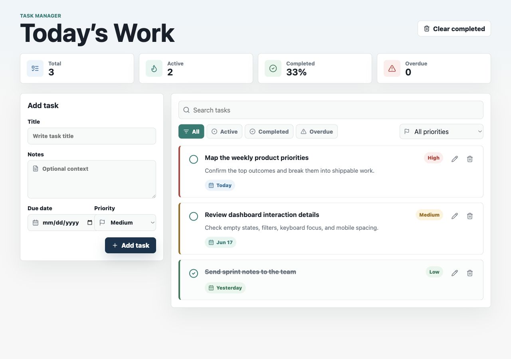
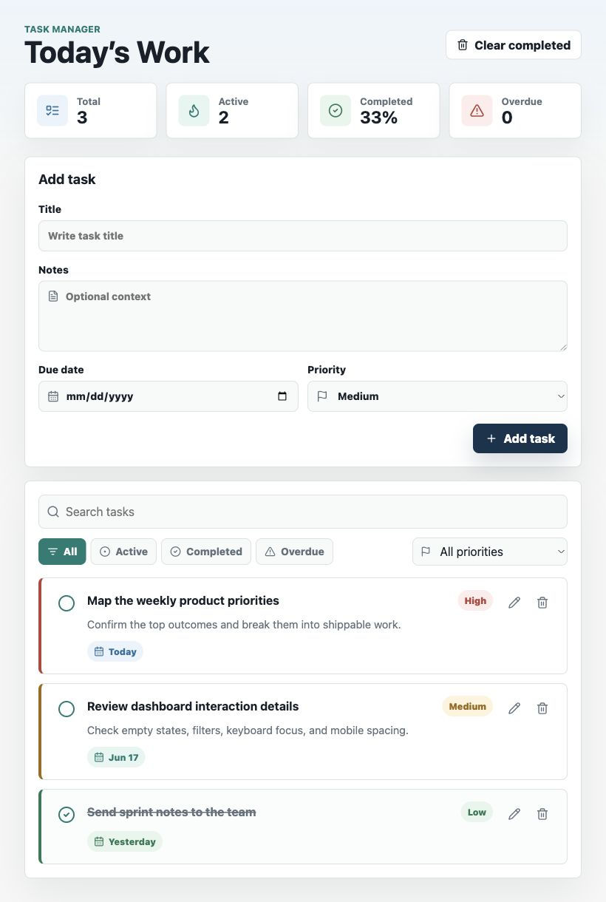
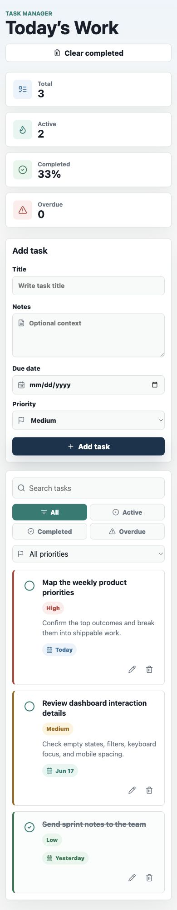

# Task Manager App

A polished React task management application built as a portfolio-ready project. It helps users capture tasks, organize work by priority and due date, search quickly, and keep progress saved in the browser with `localStorage`.

## Features

- Add, edit, delete, and complete tasks
- Due dates with overdue detection
- Priority levels: high, medium, and low
- Filters for all, active, completed, overdue, and priority-specific views
- Search across task titles and notes
- Local persistence with `localStorage`
- Loading, empty, and error states
- Responsive layout for desktop, tablet, and mobile
- Reusable React components with a clean folder structure

## Tech Stack

- React
- Vite
- JavaScript
- CSS
- lucide-react
- localStorage

## Project Structure

```text
task-manager-app/
  public/
  src/
    components/
    data/
    hooks/
    utils/
    App.jsx
    main.jsx
    styles.css
  index.html
  package.json
  README.md
```

## Getting Started

Prerequisite: Node.js `20.19.0` or newer. The repo includes `.nvmrc` and `.node-version` for version managers.

Install dependencies:

```bash
npm install
```

Run the development server:

```bash
npm run dev
```

Build for production:

```bash
npm run build
```

Preview the production build:

```bash
npm run preview
```

## Screenshots

### Desktop



### Tablet



### Mobile



## Future Improvements

- Drag-and-drop task ordering
- Task categories or projects
- Recurring tasks
- Calendar view
- Export and import task data
- Optional cloud sync and authentication

## Deployment

This app can be deployed to any static hosting provider.

### Vercel

1. Import the GitHub repository.
2. Use the default Vite settings.
3. Build command: `npm run build`
4. Output directory: `dist`

### Netlify

1. Connect the GitHub repository.
2. Build command: `npm run build`
3. Publish directory: `dist`

### GitHub Pages

1. Run `npm run build`.
2. Publish the `dist` directory using a GitHub Pages workflow or a Pages-compatible deployment action.
